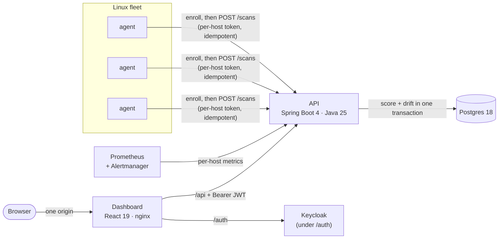

# Driftwatch

[](https://github.com/TahaUsama210/driftwatch/actions/workflows/ci.yml)
[](LICENSE)

**Continuous CIS-style compliance scanning for a Linux fleet, with drift detection.**

A small Go agent on each host checks SSH, account, kernel and network hardening. It
reports to a Spring Boot API, which scores every scan and records exactly which control
changed and when. A React dashboard, behind single sign-on, shows the fleet's posture,
each host's history and a live feed of regressions. Prometheus alerts fire when a host
falls out of compliance. The stack runs on Docker Compose or Kubernetes, and Terraform
describes an AWS test fleet.

<picture>
  <source media="(prefers-color-scheme: dark)" srcset="docs/screenshots/overview-dark.png">
  
</picture>

## Why

Hardening a server once is easy. Keeping a fleet hardened is the hard part. A teammate
re-enables root login to debug something, a package update resets a sysctl, and the
server quietly falls out of compliance until the next audit. Driftwatch re-checks every
host continuously and treats each change in a control's status as an event: what
regressed, on which host, in which scan.

## Quick start

Requires Docker with Compose v2.

```sh
docker compose up --build
```

Open **http://localhost:8400** and sign in as `viewer` / `viewer-demo` (read-only) or
`admin` / `admin-demo` (can also decommission hosts). Compose builds and starts
Postgres, Keycloak, the API, the dashboard and a demo fleet of four Linux hosts, each
running the real agent:

| Demo host | Base image | Posture | Score |
|---|---|---|---|
| `ubuntu-hardened` | Ubuntu 24.04 | nearly everything passes | 93.9 |
| `alpine-drifting` | Alpine 3.22 | flips `PermitRootLogin` every 2 minutes to generate live drift | 95.8 ↔ 89.6 |
| `rocky-web` | Rocky Linux 9.8 | mixed, IP forwarding on | 83.7 |
| `debian-legacy` | Debian 12.14 | weak SSH config, lax password policy, an extra UID-0 account | 46.9 |

The scores are the values measured on the running stack. They're deterministic because
compose fixes each host's network sysctls (see
[`deploy/hosts/README.md`](deploy/hosts/README.md)). The API is at
http://localhost:8480, with Swagger UI at `/swagger-ui.html`. The demo users, client
secrets and Keycloak's dev mode are for this localhost-only stack.

**Alerts and dashboards:** `docker compose --profile observability up --build` adds
Prometheus (http://localhost:39090), Alertmanager (:39093) and Grafana (:33000). Within a
few minutes `DriftwatchCriticalControlFailing` fires for `debian-legacy` and
`DriftwatchComplianceRegression` for `alpine-drifting`.

**Kubernetes:** `make k8s-up` creates a local k3d cluster, installs both Helm charts and
serves the dashboard at http://localhost:38080; `make k8s-smoke` and `make k8s-down`
test and remove it ([`deploy/k3d/`](deploy/k3d/)).

On Windows, run the compose commands directly or use Git Bash for the `make` targets
and scripts.

## Screenshots

| Host detail: score history and scan-to-scan drift | Check catalog across the fleet |
|---|---|
|  |  |


## How it works



1. The **agent** evaluates 21 checks modeled on CIS Benchmark Level 1 controls
   (`sshd_config` with real OpenSSH semantics, `/etc/shadow` and `/etc/passwd`,
   `login.defs`, kernel and network sysctls, file permissions). It submits the results
   with a client-generated `scanId`.
2. The **API** authenticates the host by the hash of its token and locks the host row. In
   one transaction it stores the scan, computes a severity-weighted score, and diffs the
   results against the host's previous scan to produce `REGRESSED` / `RESOLVED` /
   `CHANGED` drift events.
3. The **dashboard** signs the user in through Keycloak and reads fleet summary, trend,
   host history, the check catalog and the events feed, refreshing every 15 seconds.
4. **Prometheus** scrapes per-host score, last-seen and failing-check gauges and a
   per-host drift counter, and five alert rules route through Alertmanager by severity.

More detail: [architecture](docs/ARCHITECTURE.md) · [contracts and domain rules](docs/CONTRACTS.md) · [decision records](docs/adr/).

## Engineering highlights

- **Contract-first API.** [`contracts/openapi.yaml`](contracts/openapi.yaml) was
  written before any code. The API's integration tests validate every real response
  against it. The dashboard generates its TypeScript types from it, and CI fails if the
  committed types differ from what the generator produces.
- **Authorization enforced by the API, not the UI.** The dashboard signs in with
  Authorization Code + PKCE against Keycloak served on the same origin, and keeps tokens
  in memory only. The API accepts only RS256 tokens with the exact issuer, audience,
  expiry and subject, and reads roles from `realm_access`. Dashboard and agent endpoints
  are separate security chains, so neither credential works on the other's endpoints. If
  Keycloak is unreachable, the API stays ready and answers `503` rather than a misleading
  `401` ([ADR 5](docs/adr/0005-same-origin-oidc-with-keycloak.md)).
- **Retries can't double-count.** Agents retry with exponential backoff and jitter,
  reusing the same `scanId`. A duplicate returns `200` with the stored result; the same
  `scanId` from another host is `409`.
- **Consistent drift under concurrency.** Ingest locks the host row, so two concurrent
  submissions can't diff against the same baseline. Scans that arrive out of order are
  slotted into history, and the next scan's events are rebuilt. Decommissioning takes the
  same lock, so a scan racing a decommission is either deleted with the host or rejected.
  Deterministic tests cover these races.
- **Least-privilege credentials.** A shared enrollment token is exchanged for a per-host
  token. The API stores only the SHA-256 of agent tokens, compares secrets in constant
  time, and rotates a token on re-enrollment. Tokens are redacted in every log format, and
  each decommission writes an audit line naming the actor.
- **An agent that survives a hostile host.** It's stdlib-only Go in a 3.9 MB image, and
  every check reads through a filesystem abstraction, so the tests run on any OS. Reads
  are confined to the scanned root, skip non-regular files (a FIFO can't hang a scan),
  and cap `Include` expansion at 256 files or 8 MiB.
- **Alerts that are tested.** Five Prometheus rules (API down, host not reporting,
  critical control failing, low compliance, per-host regression) have `promtool` unit
  tests for both firing and not firing, including counter resets after an API restart.
- **Kubernetes with least privilege.** The control plane runs under Pod Security
  `restricted` with default-deny NetworkPolicies, which were probed from inside pods on a
  live k3d cluster: allowed paths work and the rest are blocked. The node agent DaemonSet
  mounts only the node's `/etc`,
  `/usr/lib` and `/proc`, read-only, with one capability
  ([ADR 6](docs/adr/0006-node-agent-daemonset.md)).
- **An AWS fleet in Terraform, tested without an AWS account.** Network, SSM-only
  instance role, k3s control plane and a mixed-distro fleet, with no SSH, IMDSv2 only and
  encrypted volumes. The enrollment token is written to SSM write-only, so it never
  enters state. Every security requirement is a `terraform test` assertion against a
  mocked provider.
- **A supply chain you can verify.** Multi-arch images are scanned with Trivy (fixable
  HIGH/CRITICAL fails the build), signed with cosign by digest, and get SBOM and
  provenance attestations. Releases build agent archives with fixed timestamps and
  ownership plus a checksums file, and run only for tags on `main`. Third-party actions
  are pinned to commit SHAs. The publishing workflows haven't run yet: they start on the
  first push to `main` and the first tag.
- **Errors are RFC 9457 problem+json everywhere**, including validation field paths
  (`results[3].checkId`), 413 for bodies over 1 MiB, and requests rejected by the
  security firewall.

## Test results

Measured locally on the final code:

| Component | Suite | Result |
|---|---|---|
| Agent (Go) | unit tests with the race detector | pass, 96.1% statement coverage of `internal/...` |
| API (Java) | 112 unit + 126 Testcontainers integration tests (Postgres and a real Keycloak) | 238 pass, 98.2% line coverage (JaCoCo) |
| Dashboard (TypeScript) | Vitest + Testing Library + MSW | 159 pass, 94.2% line coverage |
| Browser | Playwright: real Keycloak login, roles, decommission, sign-out | 6 / 6 pass on compose and on k3d |
| Whole stack (compose) | [`scripts/smoke.sh`](scripts/smoke.sh), auth included | 32 / 32 checks pass |
| Whole stack (Kubernetes) | [`deploy/k3d/smoke.sh`](deploy/k3d/smoke.sh) on a 3-node k3d cluster | 8 / 8 checks pass |
| Alerts | `promtool test rules` | 19 tests, 34 evaluations pass |
| Helm charts | helm-unittest, `kubeconform -strict`, Trivy | 55 + 16 tests pass; Trivy clean apart from one documented exception (the agent's hostPath mounts) |
| Terraform | `terraform test` with a mocked AWS provider, tflint, Trivy | 75 tests pass; tflint clean; Trivy clean with six inline, justified exceptions |

Every behavioural bug fixed during code review has a regression test that fails without
the fix.

## Repository layout

| Path | What |
|---|---|
| [`agent/`](agent/) | Go agent: checks, sshd evaluator, client, runner ([README](agent/README.md)) |
| [`api/`](api/) | Spring Boot API: auth, ingest, scoring, drift, decommission, metrics ([README](api/README.md)) |
| [`web/`](web/) | React dashboard and its nginx image ([README](web/README.md)) |
| [`e2e/`](e2e/) | Playwright browser tests against a running stack ([README](e2e/README.md)) |
| [`deploy/hosts/`](deploy/hosts/) | Demo fleet images and their expected results ([README](deploy/hosts/README.md)) |
| [`deploy/observability/`](deploy/observability/) | Prometheus rules and tests, Alertmanager, Grafana, runbook ([README](deploy/observability/README.md)) |
| [`deploy/helm/`](deploy/helm/), [`deploy/k3d/`](deploy/k3d/) | Helm charts for the control plane and the node agent; local k3d cluster ([README](deploy/helm/README.md)) |
| [`infra/terraform/`](infra/terraform/) | AWS test fleet modules and tests ([README](infra/terraform/README.md)) |
| [`contracts/`](contracts/) | OpenAPI contract shared by all components |
| [`docs/`](docs/) | Architecture, domain rules, ADRs |
| `docker-compose.yml`, [`Makefile`](Makefile), [`scripts/`](scripts/), [`.github/`](.github/) | Local stack, task runner, checks, CI and releases |

## Development

`make help` lists every target. The main ones:

```sh
make up          # build and start the stack, wait until healthy
make test        # agent, API and dashboard test suites
make lint        # every linter, including the contract and CI config
make check-iac   # Terraform, Helm, observability and Dockerfile checks (Docker only)
make smoke       # end-to-end checks against the running stack (needs curl and jq)
make e2e         # Playwright browser tests against the running stack
```

Toolchains for working on a component directly: Go 1.27, Java 25 (the Maven wrapper is
included), Node 22.22 or newer (`web/.nvmrc`). Each component's README covers its own
commands.

## Known limitations

- `Match` blocks in `sshd_config` aren't evaluated. The evidence says so when one would
  override a value.
- Containers inherit `kernel.randomize_va_space` from the Docker host, so the demo
  shows the host's ASLR setting. On Kubernetes the agent runs without host networking by
  default, so the four `network.*` checks report the pod's network namespace, not the
  node's ([ADR 6](docs/adr/0006-node-agent-daemonset.md)).
- Keycloak runs in dev mode with demo credentials. A real deployment needs its production
  mode, a database and real secrets.
- The Terraform has only been tested against a mocked provider; it has never been
  applied to a real AWS account.

## Roadmap

- **Phase 3: remediation and integrations.** Ansible playbooks triggered from the
  dashboard with a dry-run mode, and a read-only MCP server ("which hosts fail SSH
  controls?") with scoped permissions and an audit log.

## License

[MIT](LICENSE)
