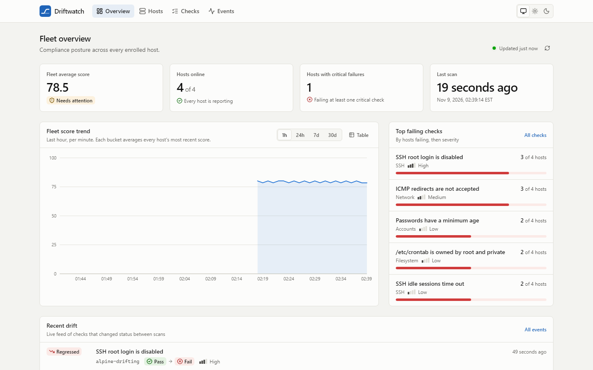
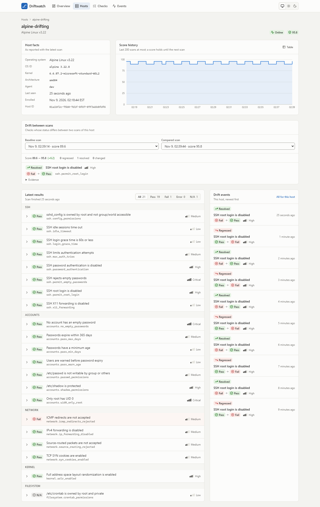
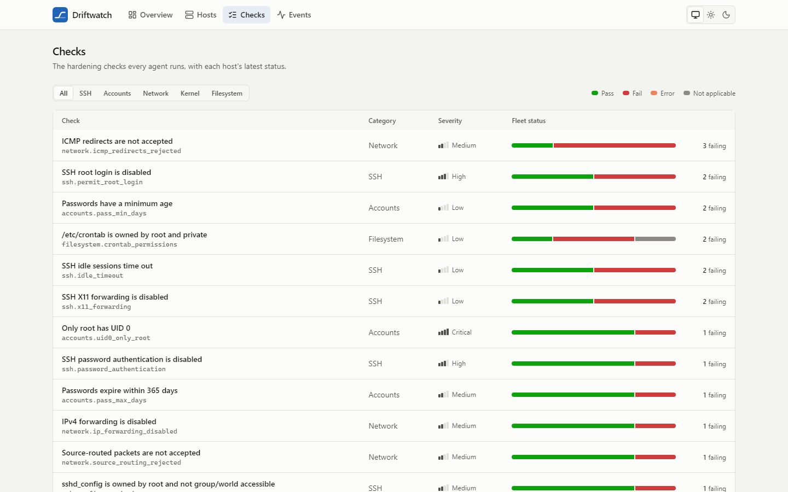
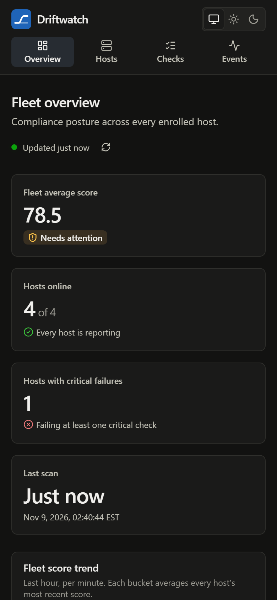
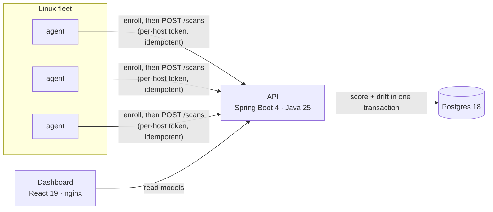

# Driftwatch

**Continuous CIS-style compliance scanning for a Linux fleet, with drift detection.**

A small Go agent on each host checks SSH, account, kernel and network hardening. It
reports to a Spring Boot API, which scores every scan and records exactly which control
changed and when. A React dashboard shows the fleet's posture, each host's history, and a
live feed of regressions.

<picture>
  <source media="(prefers-color-scheme: dark)" srcset="docs/screenshots/overview-dark.png">
  
</picture>

## Why

Hardening a server once is easy. Keeping a fleet hardened is the hard part. A teammate
re-enables root login to debug something, a package update resets a sysctl, and the
server quietly falls out of compliance until the next audit. Driftwatch re-checks every
host continuously and treats each change in a control's status as an event: what
regressed, on which host, in which scan.

## Quick start

Requires Docker with Compose v2.

```sh
docker compose up --build
```

Open **http://localhost:8400**. Compose builds and starts Postgres, the API, the
dashboard and a demo fleet of four Linux hosts, each running the real agent:

| Demo host | Base image | Posture | Score |
|---|---|---|---|
| `ubuntu-hardened` | Ubuntu 24.04 | nearly everything passes | 93.9 |
| `alpine-drifting` | Alpine 3.22 | flips `PermitRootLogin` every 2 minutes to generate live drift | 95.8 ↔ 89.6 |
| `rocky-web` | Rocky Linux 9.8 | mixed, IP forwarding on | 83.7 |
| `debian-legacy` | Debian 12.14 | weak SSH config, lax password policy, an extra UID-0 account | 46.9 |

The scores are the values measured on the running stack. They're deterministic because
compose fixes each host's network sysctls (see
[`deploy/hosts/README.md`](deploy/hosts/README.md)). The API is at
http://localhost:8480, with Swagger UI at `/swagger-ui.html`.

On Windows, run the compose commands directly or use Git Bash for the `make` targets
and `scripts/smoke.sh`.

## Screenshots

| Host detail: score history and scan-to-scan drift | Check catalog across the fleet |
|---|---|
|  |  |



## How it works



1. The **agent** evaluates 21 checks modeled on CIS Benchmark Level 1 controls
   (`sshd_config` with real OpenSSH semantics, `/etc/shadow` and `/etc/passwd`,
   `login.defs`, kernel and network sysctls, file permissions). It submits the results
   with a client-generated `scanId`.
2. The **API** authenticates the host by the hash of its token and locks the host row. In
   one transaction it stores the scan, computes a severity-weighted score, and diffs the
   results against the host's previous scan to produce `REGRESSED` / `RESOLVED` /
   `CHANGED` drift events.
3. The **dashboard** reads fleet summary, trend, host history, the check catalog and the
   events feed, refreshing every 15 seconds.

More detail: [architecture](docs/ARCHITECTURE.md) · [contracts and domain rules](docs/CONTRACTS.md) · [decision records](docs/adr/).

## Engineering highlights

- **Contract-first API.** [`contracts/openapi.yaml`](contracts/openapi.yaml) was
  written before any code. The API's integration tests validate every real response
  against it. The dashboard generates its TypeScript types from it, and CI fails if the
  committed types differ from what the generator produces.
- **Retries can't double-count.** Agents retry with exponential backoff and jitter,
  reusing the same `scanId`. A duplicate returns `200` with the stored result; the same
  `scanId` from another host is `409`.
- **Consistent drift under concurrency.** Ingest locks the host row, so two concurrent
  submissions can't diff against the same baseline. Scans that arrive out of order are
  slotted into history, and the next scan's events are rebuilt. Deterministic tests cover
  the lock races: a token rotated, or a `scanId` claimed by another host, while a
  submission waits for the lock.
- **Least-privilege credentials.** A shared enrollment token is exchanged for a per-host
  token. The API stores only the SHA-256 of agent tokens, compares secrets in constant
  time, and rotates a token on re-enrollment. Tokens are redacted in every log format.
- **An agent that survives a hostile host.** It's stdlib-only Go in a 3.9 MB image, and
  every check reads through a filesystem abstraction, so the tests run on any OS. Reads
  are confined to the scanned root, skip non-regular files (a FIFO can't hang a scan),
  and cap `Include` expansion at 256 files or 8 MiB.
- **Errors are RFC 9457 problem+json everywhere**, including validation field paths
  (`results[3].checkId`), 413 for bodies over 1 MiB, and requests rejected by the
  security firewall.
- **Hardened containers.** The API and dashboard run as non-root with all Linux
  capabilities dropped and `no-new-privileges`. nginx sends a strict CSP. All ports bind
  to `127.0.0.1`.
- **CI** ([`ci.yml`](.github/workflows/ci.yml)) lints the contract, workflows, shell
  scripts and compose file, and tests each component. It builds all seven images, then
  boots the whole stack and runs a 17-check end-to-end smoke test. Third-party actions
  are pinned to commit SHAs.

## Test results

Measured locally on the final code:

| Component | Suite | Result |
|---|---|---|
| Agent (Go) | unit tests with the race detector | pass, 96.1% statement coverage of `internal/...` |
| API (Java) | 96 unit + 84 Testcontainers integration tests | 180 pass, 97.7% line coverage (JaCoCo) |
| Dashboard (TypeScript) | Vitest + Testing Library + MSW | 104 pass, 92.3% line coverage |
| Whole stack | [`scripts/smoke.sh`](scripts/smoke.sh) against `docker compose` | 17 / 17 checks pass |

Every behavioural bug fixed during code review has a regression test that fails without
the fix.

## Repository layout

| Path | What |
|---|---|
| [`agent/`](agent/) | Go agent: checks, sshd evaluator, client, runner ([README](agent/README.md)) |
| [`api/`](api/) | Spring Boot API: ingest, scoring, drift, read models ([README](api/README.md)) |
| [`web/`](web/) | React dashboard and its nginx image ([README](web/README.md)) |
| [`deploy/hosts/`](deploy/hosts/) | Demo fleet images and their expected results ([README](deploy/hosts/README.md)) |
| [`contracts/`](contracts/) | OpenAPI contract shared by all components |
| [`docs/`](docs/) | Architecture, domain rules, ADRs |
| `docker-compose.yml`, [`Makefile`](Makefile), [`scripts/`](scripts/), [`.github/`](.github/) | Local stack, task runner, smoke test, CI |

## Development

`make help` lists every target. The main ones:

```sh
make up       # build and start the stack, wait until healthy
make test     # agent, API and dashboard test suites
make lint     # every linter, including the contract and CI config
make smoke    # end-to-end checks against the running stack (needs curl and jq)
```

Toolchains for working on a component directly: Go 1.27, Java 25 (the Maven wrapper is
included), Node 22.22 or newer (`web/.nvmrc`). Each component's README covers its own
commands.

## Known limitations

- `Match` blocks in `sshd_config` aren't evaluated. The evidence says so when one would
  override a value.
- The read API and dashboard are unauthenticated in this phase.
- Containers inherit `kernel.randomize_va_space` from the Docker host, so the demo
  shows the host's ASLR setting.

## Roadmap

- **Phase 2: infrastructure.** Terraform for a disposable AWS test fleet, k3s + Helm
  for the control plane, Trivy image scanning and image publishing in CI, Prometheus
  alerts when a host falls out of compliance, dashboard authentication.
- **Phase 3: remediation.** Ansible playbooks triggered from the dashboard with a
  dry-run mode, and a read-only MCP server ("which hosts fail SSH controls?") with
  scoped permissions and an audit log.

## License

[MIT](LICENSE)
