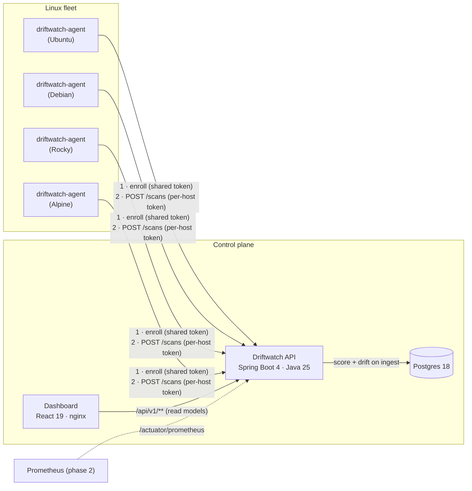

# Architecture

## System overview

## Data flow of one scan

1. The agent evaluates every check against the host filesystem and procfs, producing a
   `ScanReport` with a client-generated `scanId`.
2. It submits the report with its per-host bearer token, retrying with exponential
   backoff and the same `scanId`, so a retry can never create a second scan.
3. In one transaction the API authenticates the host by token hash, locks the host row,
   stores the scan and its results, computes the score, diffs the results against the
   host's previous scan to produce drift events, and moves the host's latest-scan pointer.
4. The dashboard reads denormalised read models: fleet summary, trend, host history,
   check catalog, drift events.

## Components

| Component | Responsibility | Key choices |
|---|---|---|
| `agent/` | Evaluate checks, report results | Go, static binary, stdlib-first, filesystem abstraction so every check is unit-tested without a real host |
| `api/` | Auth, ingest, scoring, drift, read models | Spring Boot, Flyway, Testcontainers, OpenAPI contract tests |
| `web/` | Fleet posture, host history, drift | React, TanStack Query, types generated from the OpenAPI contract |
| `deploy/hosts/` | Demo fleet with realistic, different postures | One container per distro, network sysctls set per container |
| `docker-compose.yml`, `.github/` | One-command local stack, CI | Compose healthchecks, SHA-pinned actions, end-to-end smoke test |

## Contracts

`contracts/openapi.yaml` is the single HTTP contract. The API validates its real responses
against it in tests, and the dashboard generates its TypeScript types from it. If either
side drifts from the contract, CI fails. Domain rules (scoring, drift directions,
idempotency, limits) live in [`CONTRACTS.md`](CONTRACTS.md).

## Decisions

Recorded as ADRs in [`docs/adr/`](adr/).
