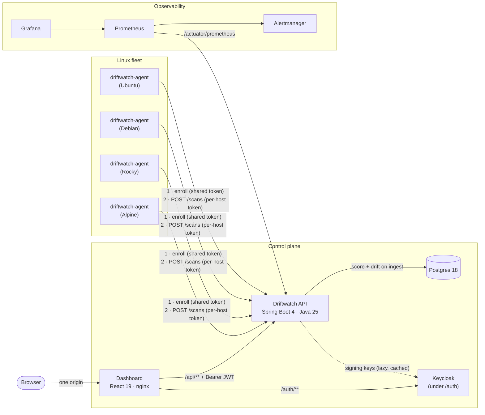

# Architecture

## System overview

## Data flow of one scan

1. The agent evaluates every check against the host filesystem and procfs, producing a
   `ScanReport` with a client-generated `scanId`.
2. It submits the report with its per-host bearer token, retrying with exponential
   backoff and the same `scanId`, so a retry can never create a second scan.
3. In one transaction the API authenticates the host by token hash, locks the host row,
   stores the scan and its results, computes the score, diffs the results against the
   host's previous scan to produce drift events, and moves the host's latest-scan pointer.
   It increments the per-host drift counters.
4. The dashboard reads denormalised read models: fleet summary, trend, host history,
   check catalog, drift events. Every read carries the signed-in user's access token.
5. Every 15 seconds the API refreshes its per-host gauges (score, last seen, failing
   checks by severity). Prometheus scrapes them, and five alert rules turn them into
   alerts: API down, host not reporting, critical control failing, low compliance, and
   a regression on a host.

## Sign-in and authorization

The dashboard, Keycloak and the API share one origin: nginx serves the SPA, proxies
`/auth/` to Keycloak and `/api/` to the API. The SPA signs in with Authorization Code +
PKCE and keeps tokens in memory. The API checks each token's signature, issuer, audience
and expiry, maps `realm_access.roles` to `viewer` / `admin`, and is the only place a role
is enforced. Agent endpoints sit on a separate security chain that accepts only agent
tokens. See [ADR 5](adr/0005-same-origin-oidc-with-keycloak.md).

Decommissioning a host (admin only) takes the same host row lock as ingest, deletes the
host with its scans, results and drift events in one transaction, revokes its agent
token, removes its metric series and writes an audit log line naming the actor.

## Deployment targets

| Target | What runs | Verified by |
|---|---|---|
| Docker Compose | Everything above, plus four demo hosts; observability behind the `observability` profile | `scripts/smoke.sh`, Playwright browser tests, CI |
| Kubernetes (k3d) | `driftwatch` chart (api, web, Keycloak, Postgres) in a Pod Security `restricted` namespace with default-deny NetworkPolicies; `driftwatch-agent` DaemonSet on every node | helm-unittest, kubeconform, `deploy/k3d/smoke.sh`, CI |
| AWS (Terraform) | k3s control plane on one EC2 instance, a fleet of Ubuntu / Debian / Amazon Linux instances running the agent from the GitHub release; SSM only, no SSH | `terraform test` with a mocked AWS provider, tflint, Trivy (never applied in CI) |

## Components

| Component | Responsibility | Key choices |
|---|---|---|
| `agent/` | Evaluate checks, report results | Go, static binary, stdlib-first, filesystem abstraction so every check is unit-tested without a real host |
| `api/` | Auth, ingest, scoring, drift, decommission, read models, metrics | Spring Boot, OAuth2 resource server, Flyway, Testcontainers (Postgres and a real Keycloak), OpenAPI contract tests |
| `web/` | Fleet posture, host history, drift, sign-in | React, TanStack Query, oidc-client-ts, types generated from the OpenAPI contract |
| `e2e/` | Browser tests against the running stack | Playwright, real Keycloak login form |
| `deploy/hosts/` | Demo fleet with realistic, different postures | One container per distro, network sysctls set per container |
| `deploy/observability/` | Alerts and dashboards | Prometheus rules with `promtool` tests, Alertmanager routing by severity, provisioned Grafana |
| `deploy/helm/`, `deploy/k3d/` | Kubernetes packaging and a local cluster | Two charts, schema-validated values, Pod Security `restricted`, NetworkPolicies |
| `infra/terraform/` | AWS test fleet | Modules for network, SSM-only instance role, control plane and fleet; mock-provider tests |
| `docker-compose.yml`, `.github/` | Local stack, CI, releases | SHA-pinned actions; multi-arch images scanned with Trivy, signed with cosign, with SBOM and provenance attestations |

## Contracts

`contracts/openapi.yaml` is the single HTTP contract. The API validates its real responses
against it in tests, and the dashboard generates its TypeScript types from it. If either
side drifts from the contract, CI fails. Domain rules (scoring, drift directions,
idempotency, limits, auth, metrics, alerts) live in [`CONTRACTS.md`](CONTRACTS.md).

## Decisions

Recorded as ADRs in [`docs/adr/`](adr/).
